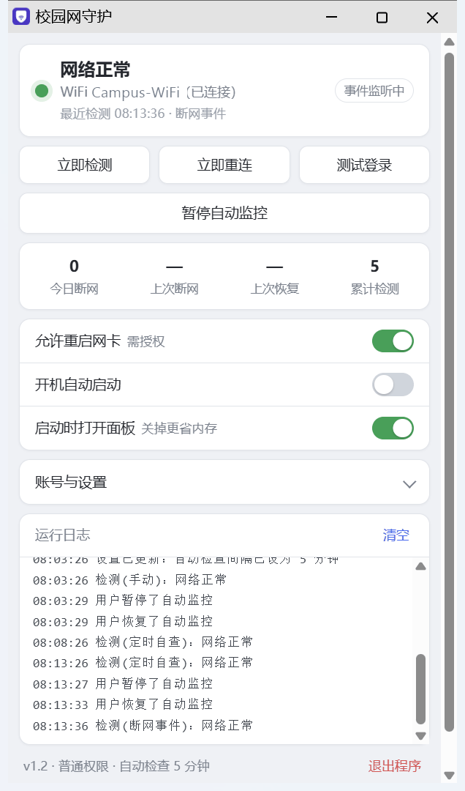
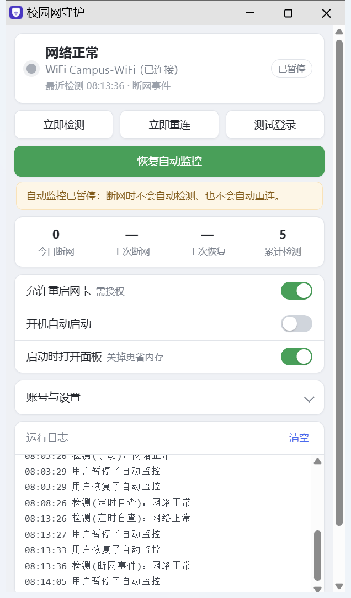

# 校园网守护

**守着你的校园网，断了就自动接回来。**

Windows 上的校园网自动重连小工具：网络掉了以后自动重新认证、重连 WiFi，恢复完再记一条日志。
**纯 Python 标准库实现，不需要安装任何第三方包**，不装驱动、不接管网卡、不改系统设置。



当前版本 **v1.3.5** ｜ MIT License ｜ 只有 Windows

> **v1.3.5 更新**：托盘图标默认收进右下角 `^` 溢出区，不再占任务栏可见位置；高级设置新增「托盘图标收进 ^」开关，关掉后重启会显示在可见区。单元测试 54 个。
>
> **v1.3.4 更新**：认证服务器地址解析统一——`10.0.0.1:99999` 这类非法端口不再出现「预检 80、登录 99999」的分裂，统一按 80 处理；IPv6 地址（`[::1]:8443`）能正确保留方括号；误填 `https://` 会明确提示只支持 http；补齐熔断与「恢复成功即停」的自动化测试。带空格的 WiFi 名（`Campus WiFi`）已做真机验证：直接关联 4.97 秒，整程序断网恢复 14.4 秒。单元测试 51 个。
>
> **v1.3.3 更新**：修掉一批「小事但真会误事」的问题——没填认证服务器时不再白等连接超时；认证服务器带端口或误填 `http://` 也能用；探测点内容校验收紧（200 空响应只对 `generate_204` 放行，劫持页不再误判成通）；门户返回 `ip_already_online_error` 也算登录成功；界面新增「高级设置」，ac_id、是否只在校园网重连、renew、托盘、探测间隔、熔断参数都能在界面里改；无控制台打包时不再做无效的控制台日志；探测和认证请求不再走系统代理。单元测试从 19 个补到 46 个。
>
> **v1.3.2 更新**：界面里的 WiFi 示例文案统一改成通用名（`Campus-WiFi`、`Campus-*`），不再出现任何具体学校的 SSID；README 的界面预览图换成 v1.3 面板重拍。功能与恢复逻辑与 v1.3.1 完全一致。
>
> **v1.3.1 更新**：修掉几处「界面上看着改了、实际没生效」的小问题——守护清单里误加的空白项会被清理、通配符支持全角 `＊`、标签点名字可直接改名、从系统 WiFi 里勾选时不再打乱已有顺序；exe 换新版本后如果界面文件还是旧的，面板会直接提示，不再静默用旧界面。恢复逻辑本身没有改动。

---

## 目录

1. [项目解决什么问题](#1-项目解决什么问题)
2. [主要功能](#2-主要功能)
3. [安装方法](#3-安装方法)
4. [使用方法](#4-使用方法)
5. [输入输出示例](#5-输入输出示例)
6. [先看它适不适合你](#6-先看它适不适合你)
7. [它什么时候才工作（不打扰你）](#7-它什么时候才工作不打扰你)
8. [恢复流水线（从轻到重）](#8-恢复流水线从轻到重)
9. [界面说明](#9-界面说明)
10. [配置项（config.json）](#10-配置项configjson)
11. [安全与隐私](#11-安全与隐私)
12. [常见问题](#12-常见问题)
13. [文件说明](#13-文件说明)
14. [自己打包 exe](#14-自己打包-exe)
15. [许可与免责](#15-许可与免责)

---

## 1. 项目解决什么问题

校园网（尤其是网页门户认证的那种）有几个很烦人的断线场景：

| 典型场景 | 现象 |
| --- | --- |
| 门户「踢下线」 | 网卡还连着、IP 也没掉，就是上不了外网 —— Windows 不会记任何事件 |
| 睡眠 / 唤醒 | 合盖再打开，认证状态没了，得手动打开认证页面重新登录 |
| 信号抖动 / 漫游 | WiFi 短暂断开又自动连回，但门户的登录状态丢了 |

学校发的客户端要么不常驻，要么只在开机时认证一次；断线之后通常得自己发现、自己开浏览器、自己点登录。

**校园网守护做的事**：常驻在右下角托盘里，等你真的上不了外网的时候，按「从轻到重」的顺序自动把连接接回来 —— 重新认证 → 重新获取 IP → 重连 WiFi →（可选）重启无线网卡；接回来写一条日志，然后继续安静待着。

**它不做什么**：不绕过计费、不共享账号、不改系统网络设置、不代理流量、不采集也不上报任何数据。

---

## 2. 主要功能

* **断线自动恢复**：4 步流水线逐级升级，每一步做完立刻重新探测，通了就停下（见第 8 节）。
* **守护多个 WiFi**：把校园网的几个 SSID（如 2.4G / 5G / 不同宿舍楼）都加进清单，连上其中任何一个都算校园网；重连时按清单顺序逐个尝试，先试上次成功连上的那个。支持 `Campus-*` 这种前缀通配。
* **事件驱动，平时不轮询**：订阅 `Microsoft-Windows-NetworkProfile/Operational` 和 `Microsoft-Windows-NCSI/Operational`，只有系统报告「网络状态变了」时才探测一次。
* **定时兜底**：默认每 5 分钟自查一次（可在界面里改成 30 秒–1 小时），专门覆盖「门户踢下线但系统不报事件」；同时能识别「从睡眠中唤醒」。
* **真探测**：不是只看网卡连没连，而是实际访问探测点并校验返回内容；被门户劫持（返回登录页）同样判为断网。
* **深澜 SRun 自动重新认证**：内置 `srun_portal` 客户端（XXTEA / HMAC-MD5 / 自定义 base64 / chksum），深澜门户开箱即用。
* **熔断保护**：连续 5 次整套恢复都失败，就暂停 10 分钟再试，避免疯狂重试拖慢系统。
* **不越界**：当前 WiFi 不在守护清单内、认证服务器也不可达时（手机热点、家里 WiFi），只在日志里说明一句，不动网络。
* **系统托盘常驻**：纯 ctypes 调用 Win32，左键打开面板、右键出菜单、悬停看当前状态。
* **本地控制面板**：424×720 的 Edge 应用小窗，实时状态、统计、日志、开关和设置都在这里（按 Esc 收起）。
* **开机自动启动**：在「启动」文件夹放一个 .vbs，免管理员、开机静默启动；在任务管理器里禁用过也能识别。
* **一键创建桌面快捷方式**（自带图标）。
* **密码加密**：Windows `DPAPI` 加密后存进 `cred.bin`，只有本机当前用户能解开。
* **日志**：面板里保留最近 500 行，同时写文件；每次启动只保留最近 7 个日志文件，程序目录写不进去时自动改写到系统临时目录。
* **单实例**：重复启动不会起两个，只会把已经在跑的面板叫到前面来。
* **只监听 127.0.0.1**：控制接口不对外，且校验 Host / Origin / Content-Type。

---

## 3. 安装方法

### 方式 A：直接用 exe（推荐，什么都不用装）

1. 到 [Releases](https://github.com/reverse-PAI/campus-network-guard/releases) 下载最新那版的 `ShouWang-v<版本>-windows.exe`（约 7 MB，单文件，自带 Python 运行时），拷到一个**固定目录**并改成好认的名字（例如 `D:\Tools\ShouWang\校园网守护.exe`；别放在下载文件夹，也别只放在桌面）；
2. 双击运行。第一次会弹出控制面板，按提示填账号密码即可。

配置、日志、加密后的密码都保存在 **exe 同级的目录**里，卸载时删掉整个目录就行（记得先关掉「开机自动启动」）。

> 单文件 exe 每次启动会把自己解包到系统临时目录，所以别把它放在只读位置。

### 方式 B：源码运行

1. 安装 [Python 3.10 或更高版本](https://www.python.org/downloads/)（代码里用了 X | None 这种写法，3.9 会报错），安装时**勾选 Add Python to PATH**；
2. 双击 **`启动.cmd`**：静默启动（用 `pythonw`，不弹黑框）。
   也可以双击 **`调试运行.cmd`**：带控制台启动，能直接在窗口里看日志，排查问题用。

两种方式都不需要 pip install 任何东西。

---

## 4. 使用方法

### 4.1 第一次使用

打开面板后，界面上会出现一条橙色引导，把「账号与设置」里的几项填好，点「保存设置」**立即生效、不用重启**：

| 填什么 | 从哪来 |
| --- | --- |
| **账号 / 密码** | 学校发的校园网账号。密码会用 Windows `DPAPI` 加密后存到 `cred.bin`，只有本机当前用户能解开 |
| **守护的网络** | 校园网 WiFi 的名字（SSID），可以加多个；点「使用当前连接」可直接把正在用的 WiFi 加进来，点「从已保存的 WiFi 中选」可从系统里已保存的配置勾选。支持 `Campus-*` 这种前缀通配（全角 `＊` 也认）。加错了点标签上的名字就能改，点 × 删掉 |
| **认证服务器** | 打开校园网认证页面时，地址栏里的那个 IP（例如 10.0.0.1） |
| **网卡接口** | 一般保持 WLAN；不确定就命令行跑 `netsh wlan show interfaces`，看「名称」那一行 |
| **自动检查** | 多久自查一次，单位秒（30–3600），右边会实时显示「5 分钟」这样的可读时长 |

填错也不要紧：没填或填得不对时，程序只会跳过「重新认证」这一步，剩下的重连照做。

第一次还想确认账号密码对不对，点界面上的 **「测试登录」**，返回「认证成功」就说明配置正确。

### 4.2 面板上的操作

| 位置 | 操作 | 说明 |
| --- | --- | --- |
| 三个按钮 | **立即检测 / 立即重连 / 测试登录** | 手动触发，不用等事件。「立即检测」只探测并自动恢复；「立即重连」会强制跑恢复流程（跳过熔断） |
| 宽按钮 | **暂停自动监控** | 暂停后按钮变成「恢复自动监控」，下方出现橙色提示条：断网时不再自动检测、自动重连 |
| 开关 | **允许重启网卡（需授权）** | 决定恢复流水线走不走第 4 步（会弹 UAC 授权框） |
| 开关 | **开机自动启动** | 在「启动」文件夹里放/删 校园网守护.vbs，立即生效 |
| 开关 | **启动时打开面板** | 默认开。关掉后双击快捷方式只留托盘图标、不弹面板 |
| 表单 | **保存设置** | 账号、密码、守护的网络（可多个，顺序就是重连时逐个尝试的顺序）、认证服务器、网卡接口、自动检查间隔 |
| 标签 | **点名字 / 点 ×** | 点标签上的名字改名（改完仍需「保存设置」），点 × 从清单里移除 |
| 表单 | **创建桌面快捷方式** | 重建桌面快捷方式（自动带上图标） |
| 日志卡 | **清空** | 只清面板里显示的内容，磁盘上的日志文件不动 |
| 右下角 | **退出程序** | 彻底结束（会先问一句）；那一刻若正在跑恢复流程，会等它收尾（最多 10 秒）再退出 |

### 4.3 托盘与窗口

| 操作 | 结果 |
| --- | --- |
| 点窗口右上角 × 或按 Esc | **只是收起面板，程序不退出**：它留在右下角托盘里继续守护网络 |
| 左键单击托盘图标（或双击） | 重新打开面板 |
| 右键单击托盘图标 | 菜单：打开面板 / 暂停·恢复自动监控 / 立即检测 / 退出程序 |
| 鼠标悬停在托盘图标上 | 显示当前状态（例如「校园网守护 · 网络正常」，暂停时显示「已暂停自动监控」） |
| 再次双击快捷方式或 exe | 不会起第二个实例，只把已有面板叫到前面来 |

### 4.4 命令行参数（源码运行同理）

```bat
校园网守护.exe                     :: 正常启动：开面板 + 托盘
校园网守护.exe --hidden            :: 静默启动：不显示控制台、不打开面板，只留托盘
校园网守护.exe --no-browser        :: 启动但不自动打开面板
校园网守护.exe --port 8800         :: 换一个面板端口（默认取配置里的 8765）
```

端口不合法（小于 1 或大于 65535）时会回落到 8765，并在日志里写一行说明。

### 4.5 只想单独试一下校园网认证

账号或门户不对、想确认账号能不能登录时，可以脱离整个程序，直接用内置的 SRun 客户端试一次：

```bat
python srun.py 账号 密码 认证服务器IP [ac_id]
```

---

## 5. 输入输出示例

### 5.1 配置：输入 `config.json`，输出「自动修正」

输入（可以手改，也可以让界面写；`config.example.json` 是模板）——完整的 17 个键：

```json
{
  "username": "",
  "portal_host": "",
  "ac_id": "1",
  "ssid": "",
  "ssid_list": [],
  "last_ssid": "",
  "interface": "WLAN",
  "only_on_campus": true,
  "periodic_seconds": 300,
  "min_interval_seconds": 8,
  "allow_renew_ip": true,
  "allow_restart_adapter": false,
  "max_fail": 5,
  "cooldown_seconds": 600,
  "port": 8765,
  "open_browser": true,
  "tray": true,
  "tray_overflow": true
}
```

把间隔写成 99999（超出 30–3600）后重新启动，程序不会崩，而是修正并记一条日志：

```text
2026-10-15 07:52:03 [WARNING] 配置项有 1 处不合法，已自动修正：periodic_seconds→3600
```

在界面里改间隔则会立刻得到回应（返回的 msg 字段，见 5.3）：

```text
"自动检查间隔已设为 1 小时（范围 30 秒–1 小时，已自动调整）"
```

### 5.2 界面操作 → 返回的消息

每个操作都会返回一句中文结果，界面直接显示成提示条（`toast`）：

| 操作（action） | 可能的返回（msg） |
| --- | --- |
| `check` | 已开始检测 |
| `reconnect` | 已开始重连 |
| `test_login` | 认证成功：login_ok ／ 认证成功：ip_already_online_error（账号本来就在线）／ 认证失败：ecode=1 密码错误 |
| `pause` / `resume` | 已暂停监控 / 已恢复监控 |
| `save` | 账号密码已加密保存 / 设置已保存 / 守护网络已保存：2 个 WiFi / 自动检查间隔已设为 5 分钟 |
| `list_profiles` | 已读取 13 个已保存的 WiFi（同时返回 `profiles` 列表和当前 `ssid`） |
| `autostart` | 已开启开机自启 / 已关闭开机自启 |
| `shortcut` | 已在桌面创建快捷方式 |
| `clear_logs` | 日志已清空 |
| `quit` | 程序已退出 |
| `panel` | 面板已打开 |
| 其它 | {"ok": false, "msg": "未知操作: xxx"} |

### 5.3 本地控制接口（127.0.0.1:8765）

面板本身就是这个接口的前端，你也可以自己调：

| 方法 | 路径 | 说明 |
| --- | --- | --- |
| GET | / 、/index.html | 控制面板页面 |
| GET | `/api/state?from=N` | 当前状态快照；from 是上次拿到的 `log_total`，只增量返回新日志 |
| POST | `/api/action` | 下发上面表格里的操作，请求体是 JSON，必须带 Content-Type: application/json |

PowerShell：

```powershell
# 看状态
Invoke-RestMethod http://127.0.0.1:8765/api/state

# 立即检测
Invoke-RestMethod http://127.0.0.1:8765/api/action -Method Post -ContentType application/json -Body '{"action":"check"}'
```

curl：

```bat
curl -X POST http://127.0.0.1:8765/api/action -H "Content-Type: application/json" -d "{\"action\":\"pause\"}"
```

**输出示例（GET /api/state，长这样；账号、SSID、门户 IP 都为占位值）**：

```json
{
  "version": "1.3.5",
  "running": true,
  "paused": false,
  "status": "online",
  "status_text": "网络正常",
  "checking": false,
  "recovering": false,
  "ssid": "Campus-WiFi",
  "adapter": "已连接",
  "last_check": "2026-10-15 07:52:04",
  "last_check_trigger": "定时自查",
  "last_probe": "http://www.msftconnecttest.com/connecttest.txt -> 正常",
  "last_down": "",
  "last_up": "",
  "today_down": 0,
  "today": "2026-10-15",
  "checks": 96,
  "fail_streak": 0,
  "cooldown_until": 0.0,
  "cooldown_left": 0,
  "last_action": "",
  "has_password": true,
  "admin": false,
  "autostart": true,
  "event_sub": true,
  "cfg": {
    "username": "20260000000",
    "portal_host": "10.0.0.1",
    "ac_id": "1",
    "ssid": "Campus-WiFi",
    "ssid_list": ["Campus-WiFi", "Campus-WiFi-5G"],
    "last_ssid": "Campus-WiFi",
    "interface": "WLAN",
    "only_on_campus": true,
    "periodic_seconds": 300,
    "min_interval_seconds": 8,
    "allow_renew_ip": true,
    "allow_restart_adapter": false,
    "max_fail": 5,
    "cooldown_seconds": 600,
    "port": 8765,
    "open_browser": true,
    "tray": true,
    "tray_overflow": true,
    "has_password": true,
    "periodic_min": 30,
    "periodic_max": 3600
  },
  "needs_setup": false,
  "logs": ["07:52:04 检测(定时自查)：网络正常"],
  "log_total": 194
}
```

**输出示例（POST `/api/action`）**：

```json
{ "ok": true, "msg": "已开始检测", "state": { "...": "完整状态快照，字段同上" } }
```

操作失败或被拒绝时也有明确回答：

```json
{ "ok": false, "msg": "未知操作: nope" }
```

```text
403 forbidden        请求来源不是本机（Host 不是 127.0.0.1 / localhost，或 Origin 不对），
                     或者 POST 没带 Content-Type: application/json
411 length required  请求体长度缺失或为负（包括 Transfer-Encoding: chunked）
413 too large        请求体超过 1 MB
404 not found        路径不存在
```

### 5.4 日志输出示例

面板里是 时:分:秒 内容，文件里是 年-月-日 时:分:秒 [级别] 内容，UTF-8：

```text
2026-10-15 07:52:03 [INFO] 已订阅事件通道 Microsoft-Windows-NetworkProfile/Operational
2026-10-15 07:52:03 [INFO] 已订阅事件通道 Microsoft-Windows-NCSI/Operational
2026-10-15 07:52:03 [INFO] 托盘图标已就绪（左键打开面板，右键出菜单）
2026-10-15 07:52:04 [INFO] 检测(启动自检)：网络正常
```

真的断线并自动接回来时是这样一段（检测后面的括号就是触发原因）：

```text
2026-10-15 06:02:03 [WARNING] 检测(定时自查)：网络不通 —— http://www.gstatic.com/generate_204 -> HTTP Error 302: Moved Temporarily
2026-10-15 06:02:03 [INFO] --- 恢复步骤：SRun 重新认证 ---
2026-10-15 06:02:03 [INFO] SRun 认证成功（login_ok）
2026-10-15 06:02:08 [INFO] 通过 [SRun 重新认证] 恢复成功（http://connect.rom.miui.com/generate_204 -> 204）
```

触发原因一共有这几种：启动自检、断网事件、定时自查、手动、手动重连、系统唤醒、已恢复监控。

### 5.5 `srun.py` 单跑示例

```text
> python srun.py
用法: python srun.py 账号 密码 认证服务器地址 [ac_id]
认证服务器地址 = 打开校园网认证页面时，地址栏里的那个 IP

> echo %errorlevel%
2
```

参数齐全时会打印两行 JSON（门户返回内容的节选 + 程序自己的判断）：

```text
online: {"error": "ok", "ecode": 0, "online_ip": "10.0.0.23", "...": "..."}
login : {"ok": true, "error": "ok", "ecode": 0, "suc_msg": "ip_already_online_error", "ip": "10.0.0.23", "...": "..."}
```

其中 "ok": true 代表认证成功：门户返回 ecode=0、error=ok，或者 ecode 直接就是 `ip_already_online_error`，三种都算。`ip_already_online_error` 说明这个 IP 本来就在线，不用再登录。

### 5.6 跑起来以后，目录里多了什么

```text
程序目录\
├─ 校园网守护.exe
├─ config.json                     首次「保存设置」后生成，不含密码
├─ cred.bin                        密码用 DPAPI 加密后的密文
└─ logs\
   └─ app-2026-10-15.log           UTF-8，文件名带日期，最多留 7 个
```

退出时（点「退出程序」或托盘菜单）日志里会补一行 程序已退出，进程和托盘图标一起消失。

---

## 6. 先看它适不适合你

| | 支持情况 |
| --- | --- |
| 系统 | **只有 Windows 10 / 11**（大量用到 Win32、`DPAPI`、事件日志、netsh、PowerShell） |
| 认证方式 | 只要你的校园网是**网页门户认证**，用「重新连一下 WiFi / 重新获取 IP」这一步就能救回来 |
| 深度适配 | **深澜 SRun 门户**（`srun_portal`）可以完整自动重新认证，不用你手动打开认证页面 |
| 不适用 | 锐捷 ePortal、Dr.COM、城市热点、802.1X、PPPoE 这些认证协议**第 1 步不生效**（会跳过并写日志），只剩 WiFi 重连和 `ipconfig /renew` |
| 有线网 | 能用，但 WiFi 那一步没意义，主要靠重新认证和重新获取 IP |

**怎么判断自己学校是不是深澜**：连上校园网后打开认证页面，按 F12 看登录请求的地址里有没有 `srun_portal`（例如 http://10.x.x.x/cgi-bin/srun_portal），页面上也常能看到「深澜软件」。是 → 开箱即用；不是 → 第 1 步会被跳过，剩下两步仍然有用，想完整支持得自己照着 `srun.py` 加一个认证适配。

> 有线网 / 非深澜门户也值得一试：程序每一步做完都会重新探测，哪一步有效就停在哪一步。

---

## 7. 它什么时候才工作（不打扰你）

* **平时不轮询**。程序订阅了 Windows 事件日志里的
  `Microsoft-Windows-NetworkProfile/Operational` 和 `Microsoft-Windows-NCSI/Operational`，
  **只有系统自己报告「网络状态变了」时才探测一次**（Windows 每次掉线都会记一条 4004 事件）。
* **自动检查**：默认每 5 分钟自己查一次，防止事件丢失（间隔可以在界面里改，30 秒–1 小时）；另外会检测「从睡眠中唤醒」。
  > 被门户「踢下线」（强制登出）时，网卡和 IP 都是好的，Windows 不会记任何事件，
  > 这种情况只有靠「自动检查」发现——所以想更快就把它调小一点。
* 探测确认**真的上不了外网**（不是只看网卡连着没连着），才会开始恢复。
  > 探测点是 `msftconnecttest.com/connecttest.txt`、`connect.rom.miui.com/generate_204`、`gstatic.com/generate_204`，
  > 会校验返回内容：前者的正文必须包含 `Microsoft Connect Test`，后两者只认 204 或空的 200；
  > 被校园网门户劫持（返回登录页或别的页面）会被判定为「没网」。

---

## 8. 恢复流水线（从轻到重）

1. **SRun 重新认证** —— 直接向认证服务器重新提交登录（深澜门户的掉线绝大多数是这个原因）
2. **`ipconfig /renew`** —— 重新获取 IP
3. **`netsh wlan connect`** —— 按顺序重连守护清单里的 WiFi：先试上次成功连上的那个，再按清单顺序逐个试，连上就停
4. **重启无线网卡** —— 最后手段，需要管理员授权（会弹 UAC）；界面里的「允许重启网卡」开关决定走不走这一步

每一步做完都会**重新探测一次**，通了就立刻停下并记日志。

**熔断保护**：连续 5 次整套流程都失败，就暂停 10 分钟再试，避免疯狂重试拖慢系统。

**不越界**：当前连的 WiFi 不在守护清单里、而且认证服务器也连不上时（比如手机热点、家里 WiFi），程序不去动网络，只在日志和面板里说明一句「当前在 XXX，不在守护清单内，未自动重连」。清单为空或没填认证服务器时不做这个判断——少了判据就照常执行恢复步骤，不会因为没配全而卡住不动。

---

## 9. 界面说明

一个 **424×720 的小窗口**，默认贴着屏幕右边、垂直居中，不占地方；按 Esc 可以直接关掉。

点「暂停自动监控」之后（按钮变绿、下面出现橙色提示条）：



* **状态灯**：绿=网络正常，红=断网，黄=正在重连/非校园网，灰=暂停或未检测
* **立即检测 / 立即重连 / 测试登录**：手动触发，不用等事件
* **开关**
  * 允许重启网卡：是否允许走到第 4 步
  * 开机自动启动：在「启动」文件夹放一个 .vbs（免管理员），开机静默启动。如果在任务管理器里把它禁用了，界面会显示为关；再打开一次就会清掉禁用记录
  * 启动时打开面板：默认开。关掉之后，双击快捷方式启动时只留一个托盘图标、不弹面板。**面板本身是一个 Edge 窗口，内存大头都在它身上（程序本体只有 30 多 MB），想最省内存就关掉它**（开机自启走的是另一条静默路径，本来就不弹面板）
* **高级设置**（在「账号与设置」里展开）：ac_id、只在校园网时重连、允许 `ipconfig /renew`、显示托盘图标、托盘图标收进 `^`（这两项改完重启生效；默认收进 `^`，关掉后显示在可见区）、探测最小间隔、熔断阈值和时长，和上面的设置一起保存
* **账号与设置**：账号、密码、**守护的网络**（输入框 + 「添加」变成小标签；标签点名字可改名、点 × 删除；也能「使用当前连接」或「从已保存的 WiFi 中选」，最多 32 个；`Campus-*` 表示前缀通配，通配符只能写在末尾）、认证服务器、网卡接口，以及 **自动检查**（多久自查一次，填秒数，右边实时显示「5 分钟」这样的可读时长；超出范围会自动夹回来），改完点「保存设置」立即生效（保存后标签会自动对齐服务端整理过的结果）。状态副标题会显示当前 WiFi 在不在清单内；如果面板文件和程序版本对不上，会弹一条提示让你重新部署 `ui.html`
* **统计**：今日断网次数、上次断网/恢复时间、累计检测次数
* **运行日志**：实时滚动，同时写入 `logs` 目录（面板只保留最近 500 行，长时间运行也不会越滚越卡）
* **底部**：v1.3.5 · 普通权限 · 自动检查 5 分钟（管理员运行时显示「管理员」）

---

## 10. 配置项（config.json）

界面里能改的项直接改就行（高级项在「高级设置」里），也可以直接编辑文件（改完重启程序生效）。仓库里的 `config.example.json` 是模板。

| 键 | 默认 | 含义 |
| --- | --- | --- |
| `username` | 空 | 校园网账号 |
| `portal_host` | 空 | 认证服务器地址（认证页面的 IP），可带端口如 `10.0.0.1:8080`；误填的 `http://` 前缀或结尾斜杠会自动去掉 |
| `ac_id` | 1 | 门户的 `ac_id`，多数学校是 1 |
| `ssid_list` | `[]` | 守护的 WiFi 清单；为空时不按 WiFi 判断。写 `Campus-*` 表示前缀通配（全角 `＊` 等价）。重复项、空白项、超过 64 字符的名字会被自动清掉，最多 32 条 |
| `last_ssid` | 空 | 上次成功连上的清单内 WiFi（程序自动记，用来决定先试哪个） |
| `ssid` | 空 | 旧版的单个 WiFi 名称；列表为空时自动迁移进 `ssid_list`，平时只作为回滚兼容字段 |
| `interface` | WLAN | 无线网卡的接口名（`netsh wlan show interfaces` 里的「名称」） |
| `only_on_campus` | true | 只在校园网 SSID（或认证服务器可达）时才自动重连 |
| `periodic_seconds` | 300 | 自动检查间隔（秒），允许 30–3600 |
| `min_interval_seconds` | 8 | 两次探测的最小间隔，防止事件抖动导致频繁探测 |
| `allow_renew_ip` | true | 允许 `ipconfig /renew` |
| `allow_restart_adapter` | false | 允许重启网卡（需管理员，会弹 UAC） |
| `max_fail` / `cooldown_seconds` | 5 / 600 | 连续失败几次熔断 / 熔断多久 |
| port | 8765 | 本地控制台端口 |
| tray | true | 是否显示系统托盘图标 |
| `tray_overflow` | true | 托盘图标是否收进 `^` 溢出区；false 则显示在可见区 |
| `open_browser` | true | 启动时自动打开控制面板 |

配置文件被写坏也不会崩：启动时会自动把不合法的项修正成默认值，并在日志里写一行说明（见 5.1）。

---

## 11. 安全与隐私

* 密码用 **Windows `DPAPI`** 加密存在 `cred.bin`，只有**本机当前用户**能解开，拷到别的电脑或别的账户都解不开；
* `config.json` 里**没有明文密码**；仓库的 `.gitignore` 已经把 `config.json`、`cred.bin`、`logs/` 排除在外，不会误传账号信息；
* 控制台只监听 127.0.0.1，外网访问不到；请求还要求来源是本机（Host 为 127.0.0.1/localhost，Origin 存在时也必须是本机）且 Content-Type: application/json，所以**本机别的网页没法偷偷调用它**；
* 程序不修改系统设置、不代理流量、不采集任何数据、不联网上报任何东西，唯一的对外请求就是探测网络和校园网认证。

---

## 12. 常见问题

**Q：会不会和学校要求的校园网客户端冲突？**
不会。本工具走的是网页门户那套 HTTP 接口，不安装驱动、不接管网卡；和官方客户端同时装也不冲突（建议别同时登录同一个账号）。

**Q：为什么日志里「探测」次数很少？**
说明网络一直正常——这正是设计目标：只在断网时才动。

**Q：改了密码后一直认证失败？**
界面里重新填密码 → 保存设置 → 点「测试登录」看返回信息。返回 ip_already_online_error 说明账号本来就在线，是正常的。

**Q：重启网卡那一步没反应？**
该步骤默认关闭，打开后会弹 UAC 授权框，拒绝授权就不会执行。也可以用管理员身份运行。

**Q：关了窗口程序还在跑吗？**
在跑。关窗口只是把面板收起来，右下角托盘里的图标还在（可能要点任务栏那个 ^ 展开才看得到）。
想彻底退出：右键托盘图标选「退出程序」，或者打开面板点右下角「退出程序」。

**Q：换 WiFi 的时候，自动重连会先试哪个？**
先试上次成功连上的那个（`last_ssid`），再按守护清单的顺序逐个试，连上就停。所以清单顺序有讲究：把最常用的放前面。
两个 SSID 只差大小写时会被当成同一条，不会重复添加。

**Q：exe 更新了，但界面看起来还是老样子？**
面板底部版本号来自程序本身，界面是单独的 `ui.html`；换版本时请把两个文件一起换。v1.3.1 起如果两者对不上，面板会弹「面板是 x，程序是 y，请重新部署 ui.html」。另外 Windows 偶尔缓存快捷方式图标，图标没变不代表没更新，看面板底部版本号最准。

**Q：它会把我自己开的浏览器窗口关掉吗？**
不会。面板是一个标题为「校园网守护」的 Edge 应用窗口，程序只跟踪、只操作自己拉起的那一个；你自己用浏览器打开的页面（哪怕标题一样）它不认。

**Q：杀毒软件报警 / 打不开 exe？**
打包出来的单文件 exe 偶尔会被误报，可以加白名单，或者直接用源码方式运行（方式 B）。源码只有标准库调用，可以自己审。

**Q：日志在哪？**
程序目录下的 `logs\app-年-月-日.log`，UTF-8 编码。每次启动只保留最近 7 个文件，不会越攒越多。程序目录写不进去时（比如放在只读位置），日志会自动改写到系统临时目录，功能不受影响。

**Q：怎么彻底卸载？**
① 界面里关掉「开机自动启动」→ ② 点「退出程序」→ ③ 删掉整个程序目录即可，不残留系统设置。

---

## 13. 文件说明

| 文件 | 作用 |
| --- | --- |
| `app.py` | 入口：参数解析、单实例检查、启动监控线程、启动本地控制台、挂托盘图标 |
| `tray.py` | 系统托盘图标（纯 ctypes 调 Win32，不依赖第三方库） |
| `monitor.py` | 核心：事件订阅、探测、恢复流水线、熔断、状态与日志；配置自愈与持久化 |
| `srun.py` | 深澜 SRun 认证客户端（XXTEA / HMAC-MD5 / 自定义 base64 / chksum），可 `python srun.py` 账号 密码 认证服务器 单独试登录 |
| `winutil.py` | Windows 工具：`DPAPI` 加解密、子进程、WLAN、重启网卡（提权）、开机自启、窗口与快捷方式 |
| `webui.py` | 本地网页控制台（只监听 127.0.0.1） |
| `ui.html` | 控制界面 |
| `config.json` / `cred.bin` | 运行时生成：配置 / `DPAPI` 加密的密码（都不会进 git） |
| `logs` | 运行时生成：日志（文件名带启动日期，每次启动只留最近 7 个；目录不可写时退回系统临时目录） |
| `app.ico` | 程序图标，7 种尺寸（16/20/24/32/48/64/256）共约 61 KB |
| `make_icon.py` | 生成 `app.ico` 的脚本（纯标准库手写 PNG+ICO）；想换图标改这里再跑一次 |
| `icon-preview.png` / `ui-preview.png` / `ui-paused.png` | 图标预览、界面预览、暂停状态预览（文档配图） |
| `config.example.json` | 配置模板（17 个键，与程序内置默认值完全一致） |
| `ssid_rules.py` | SSID 清单的规范化与匹配规则（大小写不敏感、`*` 前缀通配），监控进程与界面共用 |
| `tests/` | 单元测试：SSID 匹配/去重规则、配置自愈（`python -m unittest discover -s tests -v`） |
| `启动.cmd` / `调试运行.cmd` | 源码方式的启动脚本（静默 / 带控制台） |
| `build.bat` | 一键打包 exe（自动找解释器、装 PyInstaller、清理中间产物） |
| .github/workflows/build.yml | GitHub Actions：推 tag 或手动触发时在 Windows 上打包并发布 Release |

---

## 14. 自己打包 exe

装一次 PyInstaller（`python -m pip install pyinstaller`），然后双击 `build.bat`，或者手动执行：

```bat
python -m PyInstaller --noconfirm --clean --onefile --noconsole ^
  --name 校园网守护 --icon app.ico --optimize 2 ^
  --exclude-module tkinter --exclude-module unittest --exclude-module pydoc ^
  --exclude-module doctest --exclude-module test --exclude-module sqlite3 ^
  --exclude-module asyncio --exclude-module multiprocessing --exclude-module xml ^
  --exclude-module pdb --exclude-module lib2to3 --exclude-module setuptools ^
  --exclude-module pip --exclude-module ssl --exclude-module _hashlib ^
  --hidden-import _md5 --hidden-import _sha1 ^
  --add-data "ui.html;." --add-data "app.ico;." app.py
```

--optimize 2 丢掉断言和文档字符串，--exclude-module 剔掉用不到的模块（探测和认证都走 http，连 ssl 都用不上），这样打出来的单文件 exe 大约 **5.5 MB**（带 Python 运行时和图标；Python 3.13 + PyInstaller 6.x 实测 5,599,809 B。GitHub Actions 用 Python 3.12 跑同一份 `build.bat`，产物约 7 MB —— 配方一样，差别只在解释器自带的运行时库）。

排掉 `_hashlib` 会顺带踢掉它带的 `OpenSSL`（`libcrypto-3.dll`，约 1.8 MB），单文件体积少掉三分之一；SRun 认证要用的 MD5/SHA1 由 Python 自带的 `_md5`/`_sha1` 顶上（CPython 3.13 里它们是内置模块，`hashlib` 会自动回退），所以 `--hidden-import` 这两个必须写上。

产物在 dist\ 目录下。exe 会把配置和日志写在**自己旁边的目录**里，所以别放在只读位置。

> 维护提醒：`build.bat`、`启动.cmd`、`调试运行.cmd` 里**不要出现中文**（注释也不行）。cmd.exe 按打开文件时的代码页解码整份脚本，UTF-8 中文被当成 cp936 双字节解析时会吞掉后面的字符（连行尾回车都可能吃掉），脚本会静默跑歪——所以这三个文件保持纯 ASCII，中文提示宁可放在 README 里。

---

## 15. 许可与免责

MIT License，见 [LICENSE](LICENSE)。

这个工具是给**自己的校园网账号**用的：它只是在你已经登录过、允许上网的设备上，把掉线的连接重新接回来，不会绕过计费、不会共享账号、也不会去动别人的网络。请遵守学校的网络使用规定，使用风险自负。